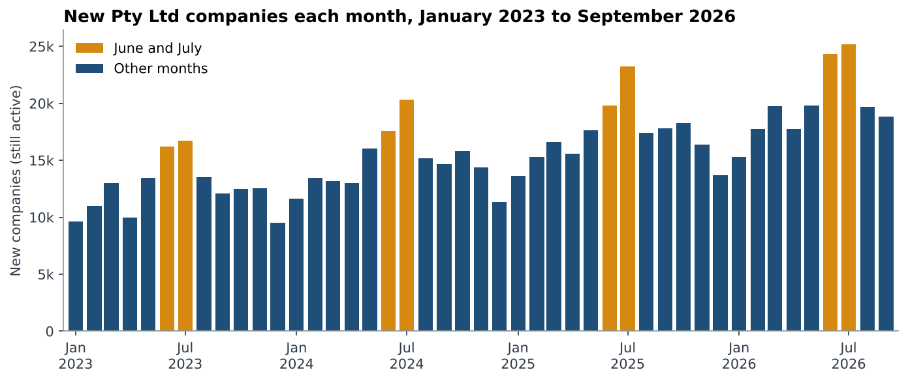
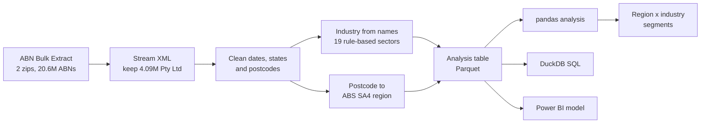
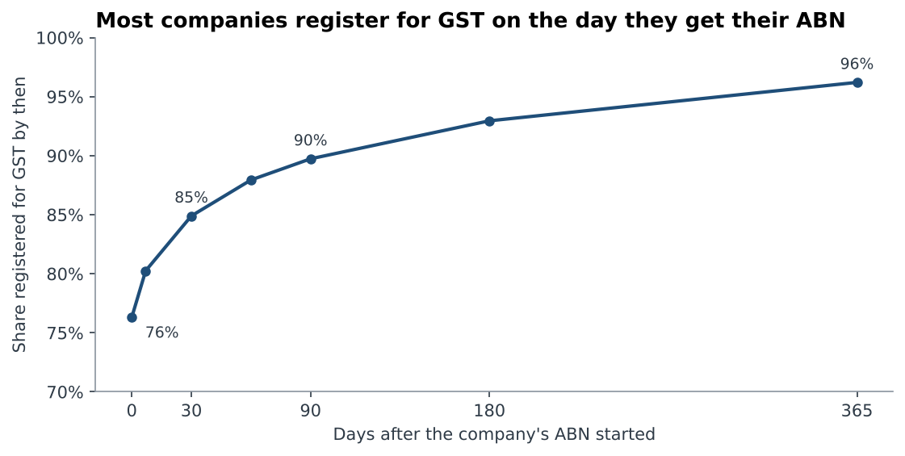
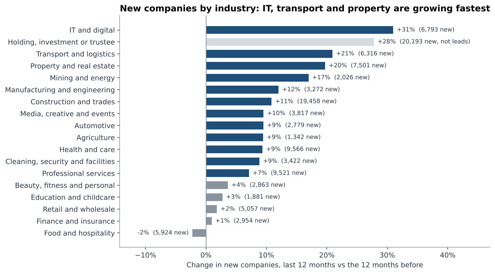
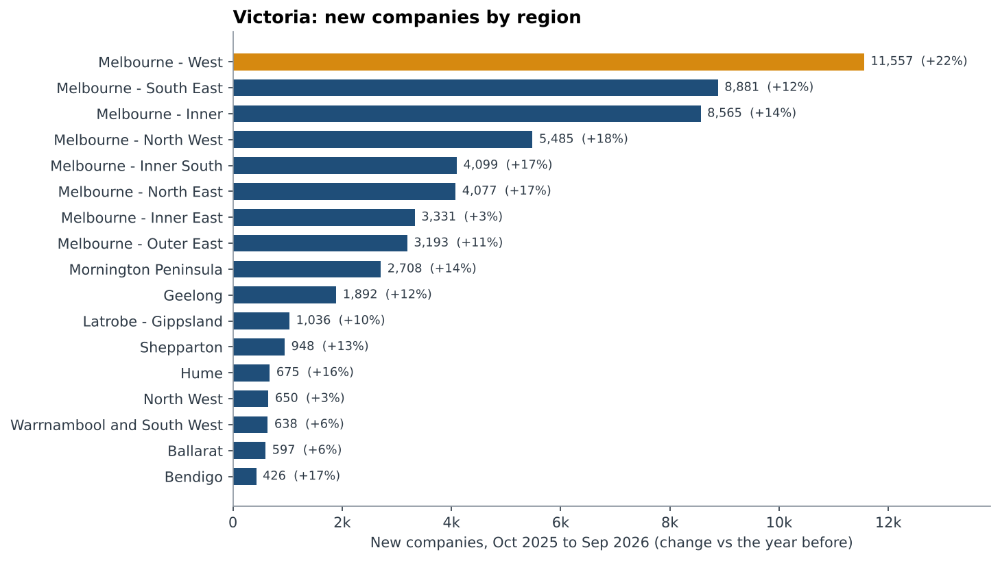
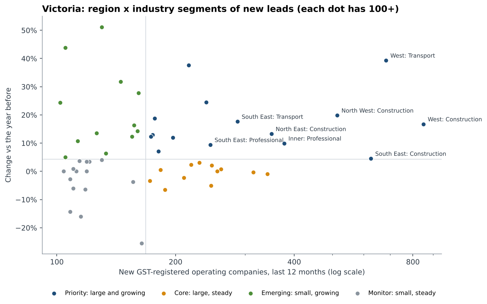

# GST-Registered Companies: Targeted Marketing


Which new Australian companies should a B2B service target, where are they, and when? This project
answers that for a Melbourne accounting and bookkeeping firm, using the **Australian Business Register's
ABN Bulk Extract**: every ABN in Australia, 12.7 GB of XML. From it I extracted **4.09 million private
companies (Pty Ltd)**, worked out each one's industry from its names, placed it in an ABS region, and
ranked Victorian region and industry segments.

The target is a **lead**: a new company that is trading (not a holding, trustee or shelf company) and
registered for GST, so it has BAS to lodge and needs bookkeeping, payroll and tax help.



## Key findings

| | Finding |
|---|---|
| Market size | **2.17 million active Pty Ltd companies**, 66% of them registered for GST |
| New companies | **226,712 new companies in the 12 months to September 2026**, 14% more than the year before. **143,523** were leads |
| Victoria | **58,859 new companies, 37,787 leads.** Victoria grew 15%, NSW 10%, WA 20% |
| When to reach them | GST registration happens at set-up: **76% of GST-registered new companies registered on the day their ABN started**, and 90% within 90 days. A company has to be contacted in its first weeks |
| When companies start | **July is the busiest month, 36% above an average month**, and June is 22% above. December and January are about 22% below |
| Fastest-growing industries | **IT and digital +31%**, transport and logistics +21%, property +20%. Food and hospitality fell 2% |
| Not every company is a lead | **9.5% of active companies are holding, trustee or numbered companies.** Only 35% of them are registered for GST, against 84% of construction and trades companies |
| Where in Victoria | **Melbourne West**: the most new companies (11,557), the fastest growth (+22%) and the most new companies per 100 existing (15) |
| Top segments | 15 priority segments, led by **Melbourne West construction and trades** (851 leads, +17%) and **Melbourne West transport and logistics** (684, +39%) |

## Recommendation for the firm

1. **Start with Melbourne's west and north west.** Melbourne West alone had 7,926 leads last year.
   With the North West, it holds five of the top ten segments.
2. **Lead with construction and transport.** They are the two largest operating sectors among new
   companies, and 84 to 85% of them register for GST, the highest of any industry.
3. **Contact companies within weeks of registration.** The ABR publishes a new extract every week. A
   weekly run of this pipeline gives a fresh list of companies a few days old, most already registered for GST.
4. **Budget for June and July.** That's when most companies start, at the start of the financial year.
5. **Filter out holding and trustee companies.** They are about 1 in 10 companies and rarely need a bookkeeper.

## Data

- **Source:** [ABN Bulk Extract](https://data.gov.au/data/dataset/abn-bulk-extract), Australian Business
  Register, via data.gov.au. Licensed CC BY 3.0 AU. The extract used was generated on **21 October 2026**.
- **What's in it:** for every ABN, its status (active or cancelled) and the date it took that status, entity type, legal
  name, business names, state and postcode of the main business location, ACN, and GST status and date.
  There is no industry code and no street address.
- **Extraction:** the two zip files hold 20 XML files of about 630 MB each (about 20.6 million ABNs). `src/extract.py`
  streams each file straight from the zip with `lxml.iterparse`, keeps the 4.09 million private companies
  (entity type `PRV`), and clears each record after reading it, so memory stays low. It takes about 2 minutes on 4 cores.
- **Cleaning:** 50 records with a status date in the future were removed. `19000101`, the ABR's placeholder for
  "no GST date", was treated as missing. 1,971 companies with no Australian state are kept as "Unknown".
- **Regions:** postcodes are mapped to ABS SA4 and SA3 regions (ASGS 2016) using a
  [community postcode file](https://github.com/matthewproctor/australianpostcodes). Where a postcode has
  several localities, the most common region is used. Two new Victorian suburb postcodes missing from the
  file were mapped by hand. 99.4% of companies matched a region.
- **The analysis table** (`data/processed/companies.parquet`, 35 MB) has one row per company with no
  names or ABNs, only the fields the analysis uses, including the derived industry and region.

## Approach



**Industry from names.** The register has no industry field, so `src/industry.py` checks the legal name and
up to five business names against keyword rules for 19 sectors ("PLUMB*", "TRANSPORT*", "CAFE" …). An
operating industry in the legal name wins. Otherwise a business name is used, so "SMITH FAMILY HOLDINGS
PTY LTD" trading as "Smith Plumbing" is a plumbing business. If neither matches, a holding-style legal name
makes it a holding or trustee company. About 53% of active companies are classified and 47% have names
that give no clue (for example "BLAFIN PTY LTD") and are left unclassified rather than guessed.
**In a hand-checked random sample of 200 classified companies, 189 (94.5%) were correct**
([`outputs/classifier_check_sample.csv`](outputs/classifier_check_sample.csv)).

**Segments.** Victorian leads from the last 12 months are grouped by SA4 region and industry. Segments
with fewer than 100 leads are dropped, because growth on small counts is mostly noise. The rest are split
at the median size (168 leads) and median growth (+4.3%) into four groups: priority (large and growing),
core (large, steady), emerging (small, growing) and monitor.

## Findings in detail

### 1. Companies register for GST at set-up



Of companies started January 2023 to September 2025 that are still active, 72% are registered for GST.
Of those, 76% have a GST date on or before their ABN start date, 85% within 30 days and 96% within a
year. Among companies less than a month old at the snapshot, 60% are already registered. So the
window to win a new company's business is at registration, not months later.

The GST date is the date registration took effect, and it can be backdated, so this measures when GST
starts, not when the form was lodged.

### 2. Industries



Growth compares companies started October 2025 to September 2026 with the 12 months before. IT and
digital grew fastest (+31%, 6,793 new companies). Food and hospitality, retail and finance barely
grew. Holding, investment and trustee companies grew 28%, which is why they need to be filtered out:
a naive count of "new companies" overstates the trading market.

### 3. Victoria by region



Melbourne West (Wyndham, Melton, Brimbank, Hobsons Bay and Maribyrnong) had 11,557 new companies,
more than Melbourne Inner (8,565), which includes the CBD. Relative to its existing base it's growing fastest too: 15 new companies per 100 existing,
against 9 in Melbourne Inner. Melbourne Inner East grew only 3%.

### 4. Segments



| Rank | Region | Industry | New leads | Change |
|---:|---|---|---:|---:|
| 1 | Melbourne - West | Construction and trades | 851 | +17% |
| 2 | Melbourne - West | Transport and logistics | 684 | +39% |
| 3 | Melbourne - South East | Construction and trades | 626 | +5% |
| 4 | Melbourne - North West | Construction and trades | 514 | +20% |
| 5 | Melbourne - Inner | Professional services | 377 | +10% |
| 6 | Melbourne - North East | Construction and trades | 350 | +13% |
| 7 | Melbourne - South East | Transport and logistics | 287 | +18% |
| 8 | Melbourne - South East | Professional services | 245 | +9% |
| 9 | Melbourne - West | IT and digital | 239 | +24% |
| 10 | Melbourne - North West | Transport and logistics | 216 | +38% |

The full ranking of 54 segments is in [`outputs/vic_segments.csv`](outputs/vic_segments.csv).

## SQL and Power BI

- **SQL:** [`sql/`](sql) has the four core queries (market by state, new companies by month, GST timing and
  Victorian segments) written for DuckDB, which queries the Parquet file directly. They use CTEs,
  `FILTER` clauses, `quantile_cont` for the medians and `ROW_NUMBER()` for the ranking. The tests check
  that every SQL result matches the pandas result.
- **Power BI:** [`powerbi/`](powerbi) has the region and sector lookup tables and a guide with the data
  model, relationships, a date table and DAX measures (leads, growth vs the previous year, GST share).

## How to run

```bash
git clone https://github.com/shameerrazvi/gst-company-targeting.git
cd gst-company-targeting
python -m venv .venv
source .venv/bin/activate        # Windows: .venv\Scripts\activate
pip install -r requirements.txt

python run_analysis.py           # uses data/processed (about 15 s)
pytest                           # 17 tests
```

To rebuild from scratch, put the two ABN Bulk Extract zip files in `data/raw/` and run
`python run_analysis.py --rebuild` (about 5 minutes). See [`data/raw/README.md`](data/raw/README.md).

## Project structure

```
gst-company-targeting/
├── data/
│   ├── raw/                  # ABN Bulk Extract zips (not committed; see README)
│   ├── reference/            # postcode file (downloaded on rebuild)
│   └── processed/            # companies.parquet: analysis table
├── src/
│   ├── extract.py            # stream the XML, keep private companies
│   ├── prepare.py            # clean, add industry and region
│   ├── industry.py           # name-based industry rules
│   ├── analysis.py           # market, trends, GST timing, sectors, regions, segments
│   ├── sql_queries.py        # run sql/ with DuckDB
│   ├── charts.py
│   └── config.py
├── sql/                      # 4 DuckDB queries
├── powerbi/                  # lookup tables + model and DAX guide
├── notebooks/gst_targeting_walkthrough.ipynb
├── outputs/                  # result tables, SQL results, summary.json
├── images/
├── tests/
└── run_analysis.py
```

## Limitations

- **Survivors only.** The extract shows each ABN's current status and the date of that status. A company
  started last year and already cancelled shows up as cancelled, with its cancellation date. So counts of
  "new companies" are companies still active today. That understates older periods, so some of the 14%
  growth is companies from the earlier year that have since closed. Ranking segments against each other is
  less affected, because the effect applies to all of them. ASIC's company register, which has registration
  dates for every company, would measure growth exactly.
- **Industry is approximate.** Rules on names are 94.5% precise on the checked sample, but 47% of
  companies can't be classified. Linking to ASIC or ATO industry codes would close that gap.
- **Location is the main business address,** which for some companies is their accountant's office.
- **GST dates can be backdated,** so timing shows when GST took effect, not when the company applied.
- **Next:** run weekly on each new extract, add business-name registration dates from ASIC to catch new
  trading names, and build the Power BI dashboard on the model in `powerbi/`.

## Sources

- [ABN Bulk Extract](https://data.gov.au/data/dataset/abn-bulk-extract), Australian Business Register (CC BY 3.0 AU)
- [ABN Bulk Extract documentation](https://abr.business.gov.au/Tools/BulkExtract): fields and weekly publication
- [Australian Postcodes](https://github.com/matthewproctor/australianpostcodes), Matthew Proctor: postcode to ABS regions

## Author

**Shameer Razvi Mir**, Data & BI Analyst, Melbourne
[LinkedIn](https://www.linkedin.com/in/shameerrazvi1998)

ABN data © Australian Business Register, CC BY 3.0 AU. Code is MIT licensed.
